<div align="center">

# $UTANG — the neighbourhood trust game

**The sari-sari store's IOU notebook, rebuilt on NEAR as a memecoin with no starting supply. Every coin is a loan between neighbours.**

[](https://testnet.nearblocks.io/address/utang-game.testnet)
[](https://nearhackathon.com/)
[](https://nearhackathon.com/)
[](https://github.com/near/NEPs/blob/master/neps/nep-0141.md)
[](https://github.com/near/NEPs/blob/master/neps/nep-0145.md)
[](#license)

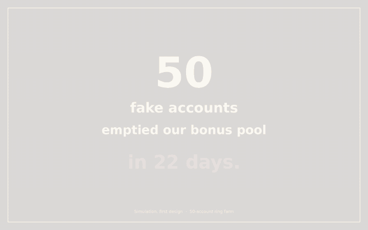

### ▶ [Watch the 30-second demo (with sound)](docs/media/utang-demo-v6.mp4)

</div>

---

## 50 fake accounts emptied our bonus pool in 22 days

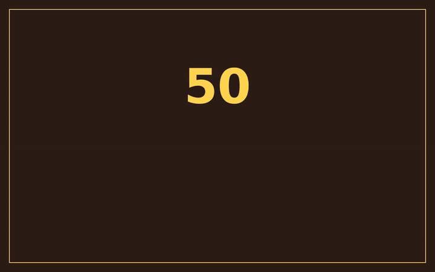

That was our **first design**, in our own 60-day simulation. A single player with 50 fake accounts lent to themselves in loops and farmed **99,876.00 of the 100,000.00 UTANG bonus pool by day 22**.

So we rewrote the rules before shipping. Same attacker, same seeds, final rules: **989.00 farmed in 60 days**, and the pool would last about 2,000 days. A patient borrow-and-run attacker dropped from **12,081.00 to 6,738.00**. Honest players lost nothing (median lending limit 35.00 → **41.62**).

Every number above comes from [`sim/output/summary.md`](sim/output/summary.md) and can be re-run with one command.

<br clear="right">

## What it is

In every Filipino neighbourhood there is a **sari-sari store**. When you're short, the owner writes your debt in the **listahan** notebook and you pay later. It only works because neighbours keep their word.

In $UTANG you run a store, your neighbours are other players, and **the only way a coin is ever created is one neighbour lending to another**. Repay on time: the debt burns, both of you gain trust, and you split a small bonus. Miss the due date: you're frozen until you pay (*bayad muna*). The total supply is a live reading of **how much a community trusts itself**.

## Gameplay

| Ask a neighbour | Repay and the ★ counts |
|---|---|
| 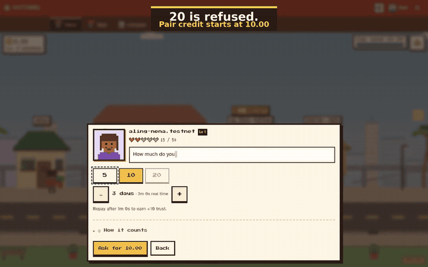 | 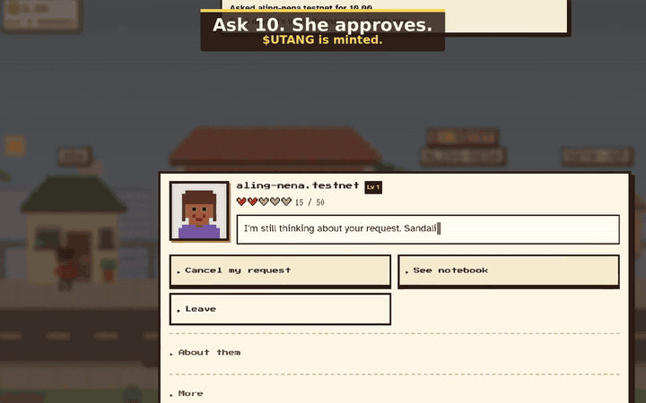 |
| **The listahan and the live economy** | **No team allocation, no presale** |
| 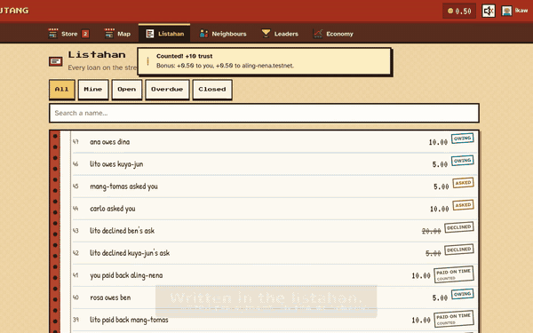 | 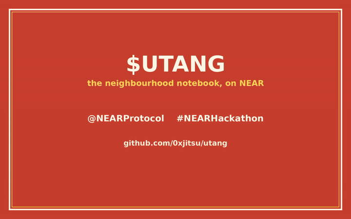 |

<details>
<summary>Full-resolution screenshots</summary>

| | |
|---|---|
| 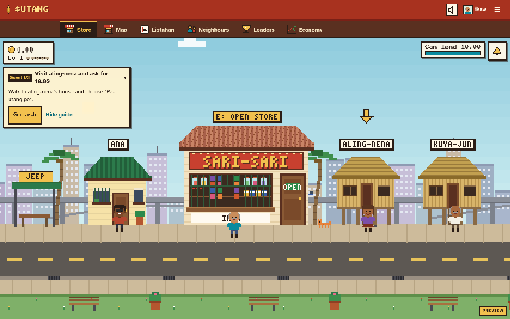 | 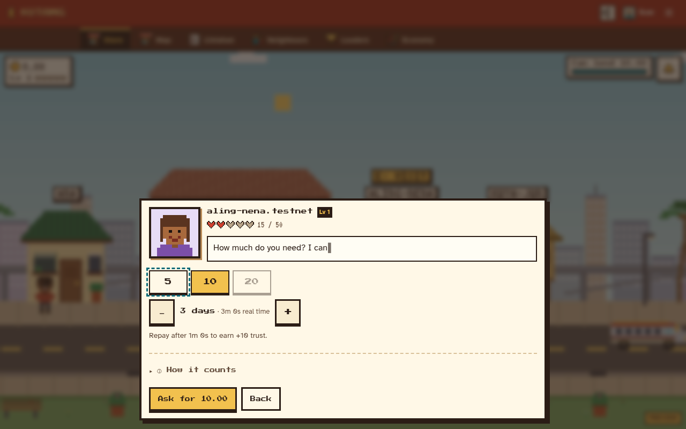 |
| 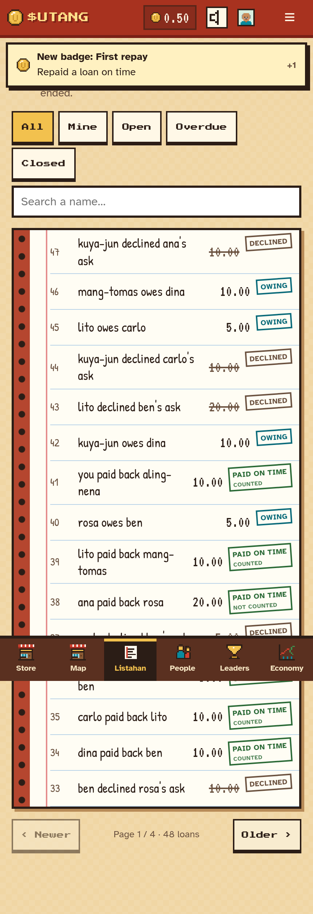 | 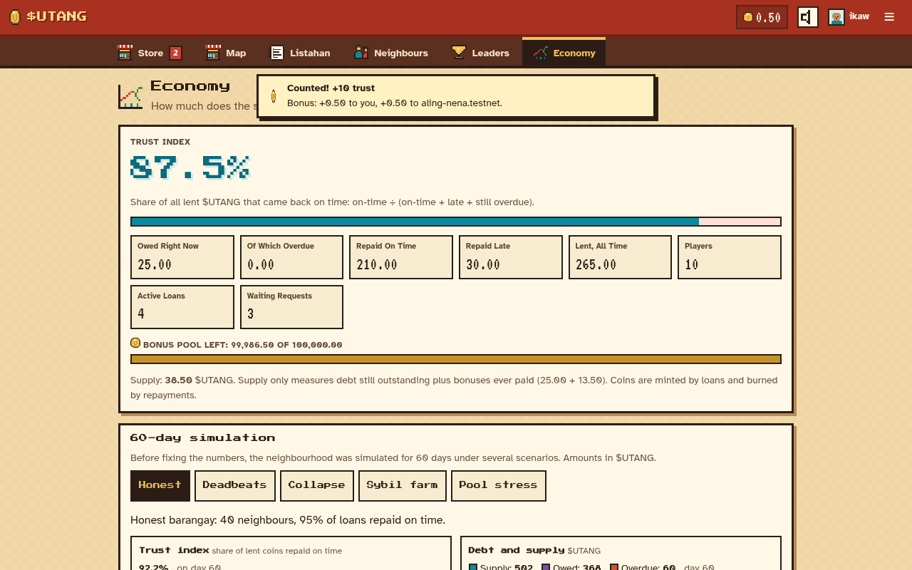 |
| 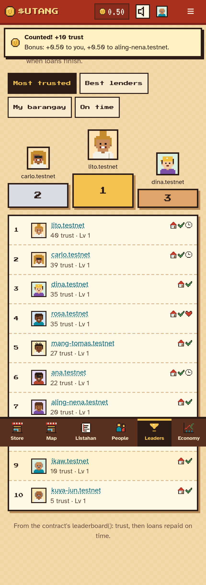 | 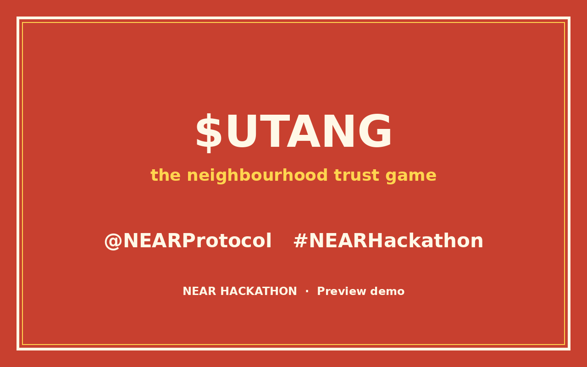 |

</details>

---

## How to play

### Humans (60 seconds, no wallet)

Requires Node 20+.

```bash
cd web && npm install && npm run dev
```

Open **[http://localhost:5173/?judge=1](http://localhost:5173/?judge=1)**. Judge mode drops you on the Hulo street already signed in, in Preview mode (in-browser mock of the contract, 1 day = 1 minute).

1. Walk with arrow keys or WASD (E or tap a house to visit). Follow the arrow to **aling-nena**.
2. Choose **Pa-utang po**. Ask for 20 and you're refused (a new pair's credit is 10.00); ask for **10** for a few days.
3. Open **≡** and press **Skip 1 day** until **Repay ★ counts** appears, then repay.
4. Open **Economy** for live supply, the trust index and the 60-day simulation.

To play for real, copy `web/.env.example` to `web/.env.local` and connect a testnet wallet (MyNearWallet, Meteor or HERE). Details in [Run the game](#run-the-game-frontend).

### AI agents (straight to the contract)

The game has no server: everything is in the contract, so an agent plays with exactly the same methods as the web app. Use the demo contract **`demo.utang-game.testnet`** (1 day = 1 minute) or **`utang-game.testnet`** (real days). Amounts are U128 strings in **centavos** (`"1000"` = 10.00 UTANG). Full spec: [`docs/INTERFACE.md`](docs/INTERFACE.md).

With [near-cli-rs](https://github.com/near/near-cli-rs), using your own testnet account (`<you>.testnet`):

```bash
C=demo.utang-game.testnet

# Read the rules and the economy (no account needed)
near contract call-function as-read-only $C rules json-args '{}' network-config testnet now
near contract call-function as-read-only $C stats json-args '{}' network-config testnet now
near contract call-function as-read-only $C leaderboard json-args '{"limit":10}' network-config testnet now

# 1. Join the neighbourhood (NEP-145 storage deposit, 0.01 NEAR)
near contract call-function as-transaction $C storage_deposit json-args '{}' \
  prepaid-gas '30.0 Tgas' attached-deposit '0.01 NEAR' \
  sign-as <you>.testnet network-config testnet sign-with-legacy-keychain send

# 2. Check how much you can borrow from a neighbour, then ask (10.00 UTANG for 3 days)
near contract call-function as-read-only $C pair_credit json-args '{"a":"<you>.testnet","b":"ana.utang-game.testnet"}' network-config testnet now
near contract call-function as-transaction $C ask json-args '{"lender":"ana.utang-game.testnet","amount":"1000","days":3}' \
  prepaid-gas '30.0 Tgas' attached-deposit '0 NEAR' \
  sign-as <you>.testnet network-config testnet sign-with-legacy-keychain send

# 3. As a lender: approve a request addressed to you (mints the loan to the borrower)
near contract call-function as-transaction $C approve json-args '{"loan_id":0}' \
  prepaid-gas '30.0 Tgas' attached-deposit '0 NEAR' \
  sign-as <you>.testnet network-config testnet sign-with-legacy-keychain send

# 4. As a borrower: repay (burns the debt; trust + bonus if the repayment counts)
near contract call-function as-transaction $C repay json-args '{"loan_id":0}' \
  prepaid-gas '30.0 Tgas' attached-deposit '0 NEAR' \
  sign-as <you>.testnet network-config testnet sign-with-legacy-keychain send

# Anyone, any time: enforce the rules on a past-due loan
near contract call-function as-transaction $C mark_overdue json-args '{"loan_id":0}' \
  prepaid-gas '30.0 Tgas' attached-deposit '0 NEAR' \
  sign-as <you>.testnet network-config testnet sign-with-legacy-keychain send
```

Your `loan_id` is returned by `ask`; also see `loans_of({"account_id":…})`, `listahan`, `overdue`, `profile` and `players` in the [method table](#contract-methods). An agent strategy is just a policy over these calls: whom to lend to (read `profile` trust and `loans_of` history), how much (`pair_credit`), and when to call `mark_overdue`. The same rules bind agents and humans; the [threat model](#limits-and-the-honest-threat-model) says plainly what fake-account agents can and can't get.

Never paste private keys into prompts, code or `.env` files; `sign-with-legacy-keychain` finds the key by account name.

---

## Why it should win

Judging, per [nearhackathon.com](https://nearhackathon.com/) and the [track prompts](https://github.com/nearai/near-hackathon-prompt-examples): AI judges first check that the project runs and does what this README says; human judges weigh technical implementation, design, impact, originality and sustainability. Track 11 is "judged on the mechanic, not the chart"; Track 09 is "judged on the game loop, not the token — bonus if players never notice the chain".

| Criterion | Evidence in this repo |
|---|---|
| **Track 11: the mechanic** | Zero starting supply; coins are minted only by an approved loan and burned on repayment ([`contract/src/lib.rs`](contract/src/lib.rs)). Supply = outstanding trust. Bonus pool hard-capped at 100,000.00 forever. |
| **Track 11 prompt requirements** | NEP-141 with the mechanic in the contract, no backend · every parameter fixed at deploy and public via `rules()`, no admin setter · Sybil limits written plainly ([threat model](#limits-and-the-honest-threat-model)) · a page with live supply and a log of every mint and burn (Economy + Listahan) · **60 days simulated first, then parameters picked** ([`sim/`](sim/)) |
| **Track 09: the game loop** | Walkable Phaser street, ask → approve → wait → repay → level up; trust unlocks bigger limits. Preview mode needs no wallet at all, so players never touch the chain until they choose Live. |
| **Technical implementation** | Rust `near-sdk` 5.30 contract with NEP-141 + NEP-145 and NEP-297 events; 62 contract unit tests in both time modes; 72 web tests; deterministic simulator that mirrors [`docs/INTERFACE.md`](docs/INTERFACE.md). Deployed: [`utang-game.testnet`](https://testnet.nearblocks.io/address/utang-game.testnet) and [`demo.utang-game.testnet`](https://testnet.nearblocks.io/address/demo.utang-game.testnet). |
| **Design** | Pixel-art sari-sari street set in Mandaluyong's 27 barangays (OpenStreetMap boundaries), Filipino copy, ZzFX sound, a 30-second demo cut. |
| **Originality** | A memecoin whose supply *is* a community's IOU book: a real informal-credit ritual turned into an onchain mechanic. |
| **Impact** | Informal store credit is everyday finance in the Philippines; $UTANG makes repayment history portable and public by account name, with no personal data stored (only a barangay name). |
| **Sustainability / honesty** | The simulation caught our own farmable first design (pool empty on day 22) and we fixed it before launch. What we **didn't** solve is written down: fake accounts can still out-rank honest players, and a patient borrow-and-run attacker can still extract 6,738.00. |
| **Reproducibility (AI screening)** | One command each: `python3 simulate.py`, `cargo test`, `npm test`, `npm run dev` → `?judge=1`. |

## Architecture

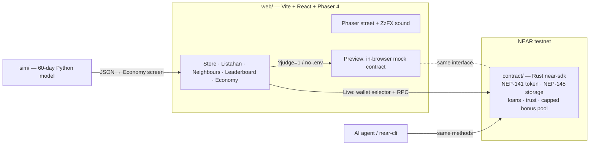

The mock, the Rust contract and the simulator all follow [`docs/INTERFACE.md`](docs/INTERFACE.md).

## Built with

| Layer | Tools |
|---|---|
| **Blockchain** | [NEAR Protocol](https://near.org/) testnet · [near-sdk-rs 5.30](https://github.com/near/near-sdk-rs) · [near-contract-standards](https://docs.rs/near-contract-standards) · [NEP-141 fungible token](https://github.com/near/NEPs/blob/master/neps/nep-0141.md) · [NEP-145 storage management](https://github.com/near/NEPs/blob/master/neps/nep-0145.md) · [NEP-297 events](https://github.com/near/NEPs/blob/master/neps/nep-0297.md) · [cargo-near](https://github.com/near/cargo-near) · [near-cli-rs](https://github.com/near/near-cli-rs) |
| **Wallets and RPC** | [NEAR Wallet Selector](https://github.com/near/wallet-selector) (MyNearWallet, Meteor Wallet, HERE Wallet modules) · [@near-js/providers](https://github.com/near/near-api-js) (from the near-api-js family) · [FastNEAR](https://fastnear.com/) testnet RPC · [NearBlocks](https://testnet.nearblocks.io/address/utang-game.testnet) explorer |
| **Game** | [Vite 7](https://vite.dev/) · [React 18](https://react.dev/) · [TypeScript](https://www.typescriptlang.org/) · [Phaser 4](https://phaser.io/) · [ZzFX](https://github.com/KilledByAPixel/ZzFX) (MIT, sound effects) · [OpenStreetMap](https://www.openstreetmap.org/copyright) (barangay boundaries, ODbL) |
| **Tests** | [Vitest](https://vitest.dev/) · [jsdom](https://github.com/jsdom/jsdom) · Rust `cargo test` with near-sdk `unit-testing` |
| **Simulation** | [Python 3](https://www.python.org/) standard library only |
| **Demo video** | [Playwright](https://playwright.dev/) (captures) · [FFmpeg](https://ffmpeg.org/) (cuts, GIFs) · [NumPy](https://numpy.org/) (procedurally synthesised budots soundtrack; no copyrighted audio) |

**Planned, not built yet:** a public token launch via [meme.cooking](https://meme.cooking/) once the rules are frozen; agent players wired through OutLayer or listed on Agent Market. None of these are integrated in this repository today.

## Team

- **Berna** — [@stickoyum](https://x.com/stickoyum) · [github.com/stickoyum](https://github.com/stickoyum)
- **mxber2022** — [github.com/mxber2022](https://github.com/mxber2022)

Sister entry at the same hackathon (separate, independent project): **GHOST WAFER**.

---

<details>
<summary><b>The full game: screens and daily loop</b></summary>

| Screen | What you do there |
|---|---|
| **My Store** | Your pixel-art shop: coin balance, trust score, level, who's visiting, open loans |
| **Listahan** | The shared notebook: every loan, who owes whom, due dates, repaid / overdue |
| **Neighbours** | Every registered player. Visit a profile, ask them for a loan, or approve their request |
| **Leaderboard** | Most trusted players, best lenders, most loans repaid on time |
| **Economy** | Live supply, trust index, bonus pool left, and the 60-day simulation |

### The daily loop

1. **Open your store.** Check your coins, debts and who has asked you for a loan.
2. **A neighbour asks.** Another player requests 5, 10 or 20 $UTANG for a few days.
3. **Decide.** Approve (you vouch for them) or decline.
4. **Wait.** The listahan tracks the due date for both of you.
5. **Get repaid.** Both players gain trust, and the bonus is shared.
6. **Level up.** Higher trust unlocks a bigger lending limit and badges.

### Set in Mandaluyong

The game is set in **Mandaluyong City**, Metro Manila. When you join you pick your **barangay** (one of the city's 27). The city map is drawn from [OpenStreetMap](https://www.openstreetmap.org/copyright) boundaries; tap a barangay and ride the jeepney into its street, where every house is a player who lives there. The game only ever stores a barangay name, never an address or location.

Everything that matters (loans, balances, trust, the player list, barangays) lives **in the contract**. The game has no server. If the website disappeared, the rules and records would still be there on NEAR.

</details>

<details>
<summary><b>How the coin works: rules, trust, parameters, supply</b></summary>

## How the coin works

```
   ana.testnet                          ben.testnet
       │   1. ben asks: "lend me 10, 7 days"    │
       │ ◄───────────────────────────────────── │
       │   2. ana approves                      │
       │ ─────────────────────────────────────► │  +10.00 UTANG minted to ben
       │                                        │  (ben owes ana 10.00)
   ── repaid on time ──────────────────────────────────────────────────
       │   3. ben repays                        │  −10.00 UTANG burned
  +0.50│ ◄────────── bonus ──────────► │+0.50   │  +1.00 UTANG from the bonus pool
  +5 trust                          +10 trust   │
   ── overdue ─────────────────────────────────────────────────────────
       │   3. due date passes; anyone calls mark_overdue
  −10 trust, lending limit halved   −20 trust, coins frozen until repaid
```

### The rules

1. **Join.** Register with a small storage deposit (NEP-145). This makes fake accounts cost real money.
2. **Ask.** The borrower asks a specific lender for an amount and a term (2–30 days; the shortest is 2 days so there is always time to repay in a way that counts). **Credit between two neighbours grows step by step:** at most 10.00 the first time, then 10.00 more for every counted repayment between them (20.00, 30.00, …). You start small with someone new, like in a real store.
3. **Approve.** The lender approves. The contract **mints** the amount to the borrower and records the debt. A lender can only have as much lent out as their **lending limit**.
4. **Repay on time.** Coins equal to the debt are **burned** from the borrower. The repayment **counts** if the loan was open at least 24 hours, the two players haven't had a counted repayment together in the last 7 days, and the borrower hasn't had one with anyone in the last day. A counted repayment gives both players **trust**, grows the lender's lending limit, and pays a **10% bonus on up to 10.00** (so at most 1.00) from the capped bonus pool, half to each side. A repayment that doesn't count still clears the debt.
5. **Overdue.** After the due date, **anyone** can call `mark_overdue`. While a borrower has an overdue loan they **cannot send $UTANG and cannot borrow**: *bayad muna* (pay first). They can still receive coins and repay. A late repayment clears the debt but earns no bonus.
6. **Lender's risk.** When a loan you approved goes overdue, **your lending limit is halved** and you lose trust. Vouch carefully.

A loan needs **both sides to agree** (ask + approve), so nobody can push a debt onto someone else.

### Trust (reputation)

Trust is a **score stored in the contract. It can't be transferred, bought or sold.** It only moves when loans finish.

| Event | Borrower | Lender |
|---|---|---|
| Loan repaid on time (counted repayment) | +10 | +5 |
| Loan marked overdue | −20 | −10 |
| Overdue loan repaid late | +5 (partial recovery) | +2 |

Trust never goes below 0. Your **level** is shown from your trust (Level 1 at 0, then every 50 points), and badges are unlocked by milestones (first loan repaid, 10 loans repaid on time, never overdue, …).

### Parameters

Fixed at deploy. Readable by anyone with `rules()`. **No admin key can change them.**

| Parameter | Value |
|---|---|
| Decimals | 2 (like pesos and centavos) |
| Join deposit | 0.01 NEAR (storage deposit, NEP-145) |
| Starting lending limit | 10.00 UTANG |
| Lending limit growth | + the amount of each loan you made that was repaid on time |
| Maximum lending limit | 1,000.00 UTANG |
| Loan term | 2–30 days |
| Credit between two neighbours | at most 10.00 × (1 + counted repayments between them) |
| On-time bonus | 10% of the first 10.00 of the loan (max 1.00): half to lender, half to borrower |
| Bonus pool | **100,000.00 UTANG in total, ever.** When it's empty, repayments still earn trust but no new coins |
| A repayment counts only if… | the loan was open ≥ 24 hours, **and** the pair had no counted repayment in the last 7 days, **and** the borrower had none in the last day |
| Only counted repayments | earn trust, grow the lending limit, and earn the bonus |
| Overdue penalty (lender) | lending limit halved, −10 trust |
| Overdue penalty (borrower) | transfers and new loans blocked until repaid, −20 trust |

### What the supply tells you

| Event | Supply |
|---|---|
| A loan is approved | ⬆ +amount |
| A loan is repaid on time | ⬇ −amount, then ⬆ bonus (while the pool lasts) |
| A loan is repaid late | ⬇ −amount |
| A loan stays unpaid | coins stay frozen with the borrower |

Because bonuses come from a fixed pool, **total supply can never exceed outstanding loans + 100,000.00 UTANG**.

The Economy screen shows the **trust index**: the share of all lent $UTANG that came back on time.

</details>

<details>
<summary><b>60-day simulation: all scenarios and the before/after table</b></summary>

## 60-day simulation

Before fixing the numbers above, we simulated 60 days of a neighbourhood playing $UTANG under several scenarios. The results are shown on the Economy screen and can be re-run with one command (see [Run it yourself](#run-it-yourself)).

| Scenario | What it tests |
|---|---|
| **Honest barangay** | 95% of loans repaid on time. Does supply grow steadily without exploding? |
| **A few deadbeats** | 70% repaid. Do the overdue rules contain the damage? |
| **Trust collapse** | Repayment drops from 95% to 40% on day 30. How fast does supply react? |
| **Sybil farm** | One player with 50 fake accounts lending to each other. What does it cost them and what can they get? |

| Scenario | Players | Loans | On time | Peak supply | Bonus minted | Bonus pool empty | Trust index, day 60 |
|---|---|---|---|---|---|---|---|
| Honest barangay | 40 | 236 | 94.6% | 516.30 | 133.80 | no | 92.2% |
| A few deadbeats | 40 | 195 | 79.8% | 514.60 | 91.10 | no | 78.9% |
| Trust collapse | 40 | 184 | 66.9% | 490.70 | 72.90 | no | 65.6% |
| Sybil farm (40 honest + 50 fake) | 90 | 1,800 | 97.2% | 8,979.30 | 1,474.60 | no | 72.3% |
| Pool stress (very active) | 10,000 | 228,846 | 92.9% | 393,649.00 | 100,000.00 | day 45, stops exactly at the cap | 92.9% |

### The simulation broke our first design

Our first rules looked fine on paper. The simulation showed they weren't, so we changed them:

| Same attacker, same seeds | First design | Final rules |
|---|---|---|
| Bonus farmed by 50 fake accounts in 60 days | 99,876.00 (**pool emptied on day 22**) | **989.00** (pool would last ~2,000 days) |
| Borrow-and-run, attacker who builds history first | 12,081.00 | **6,738.00** |
| Borrow-and-run, attacker who doesn't | 2,323.00 | **770.00** |
| Honest players' median lending limit (40-player barangay) | 35.00 | **41.62** (no cost to honest players) |

What changed: repayments only **count** after a day and once per pair per week (so instant lend-repay loops earn nothing), the bonus is capped at 1.00 per loan, and **credit between two neighbours grows step by step**. We tested four versions of that last rule against an attacker who adapts to each; `sim/output/summary.md` has the full comparison and what each one costs honest players.

What the simulation says we **didn't** fix: fake accounts can still out-rank honest players on the leaderboard, because trust can't prove identity. Very active honest players also feel the rules: in the 10,000-player run, about 36% of on-time repayments were too quick or too repetitive to count.

Full results: [`sim/output/summary.md`](sim/output/summary.md) · data: `sim/output/*.json`.

</details>

## Limits and the honest threat model

This is a hackathon demo on testnet. These are the attacks we know about and how far the rules go against them:

| Attack | What stops it | What it still allows |
|---|---|---|
| **Instant lend-and-repay loops** to pump trust and limits | A repayment only counts after the loan is 24 h old, once per pair per 7 days, once per borrower per day | Nothing: quick loops just close loans. (Our first design allowed this; the simulation caught it. See below.) |
| **Self-lending ring to farm the bonus and trust** (many accounts lending to each other) | Join deposit per account; counting rules above; bonus capped at 1.00 per loan; bonus pool capped forever | Each fake account can earn at most one counted repayment a day: ≈ 1.00 bonus and +10 trust per account per day. In the simulation a 50-account ring farmed 989.00 UTANG of bonus in 60 days (vs 99,876.00 under our first design) but still out-ranked almost every honest player (best honest player: #48 of 90). **Trust can't prove identity**; read the leaderboard with that in mind. |
| **Borrow and run** (borrow from honest neighbours, move the coins to a clean account before the due date) Credit with any neighbour grows only 10.00 per counted repayment; max 5 open loans per borrower; lenders' limits halve on every overdue loan; runners are frozen after the due date | A naive runner gets about 10.00 per honest lender. A **patient** attacker can first build real repayment history with honest lenders ("priming") and then run: in the simulation, 50 fake accounts took 6,738 UTANG this way (9,492 with an all-at-once cap, 11,042 with no cap, 12,081 under our first design). We compared four rules; see `sim/output/summary.md`. |
| **Coins sent to an overdue account** | — | They stay frozen with that account and can only be used to repay. |
| **Forcing debt on someone** | Loans need the borrower to ask *and* the lender to approve | — |
| **Admin changing the rules** | Parameters are constants; the contract account's full-access keys will be deleted after the final deploy (not yet — see [Deployment](#deployment)) | Until those keys are deleted, the deployer can still upgrade the contract |
| **Spam `mark_overdue`** | Only works after the due date on an unpaid loan; it only records what is already true | — |
| **Inflation from bonuses** | Bonus pool capped at 100,000.00 UTANG forever | — |

The contract cannot know who is a real person. Trust in $UTANG measures how accounts treated each other. It does not prove identity. Players appear by their NEAR account name only, and the game never asks for personal information.

---

## Why NEAR

- **Readable names.** The listahan reads like the real notebook: `ben.testnet owes ana.testnet 10.00`. No hex addresses.
- **Rules can be frozen.** NEAR lets us delete the contract account's keys after the final deploy, so nobody (including us) can change the rules. Those keys are still in place while we finish testing; see [Deployment](#deployment).
- **Storage deposits** give every account a real, small cost, our first line against fake accounts.
- **Fast, cheap transactions** make repaying 0.50 UTANG worth doing and make the game feel responsive.
- Standards: **NEP-141** (fungible token), **NEP-145** (storage management).

<details>
<summary><b>Developer reference: layout, contract methods, run it yourself, deployment, keys</b></summary>

## Repository layout

```
contract/   Rust smart contract (near-sdk): NEP-141 token, loans, trust, bonus pool
sim/        60-day neighbourhood simulation (Python) → JSON shown on the Economy screen
web/        The game: pixel-art store, Listahan, Neighbours, Leaderboard, Economy
```

## Contract methods

| Method | Who | What it does |
|---|---|---|
| `storage_deposit()` | anyone | Join the neighbourhood (NEP-145) |
| `set_barangay(barangay)` | player | Choose your home barangay (one of Mandaluyong's 27); can be changed any time |
| `ask(lender, amount, days)` | borrower | Request a loan; returns `loan_id` |
| `approve(loan_id)` | lender | Mint the loan to the borrower |
| `decline(loan_id)` | lender | Turn down a request |
| `cancel(loan_id)` | borrower | Withdraw a request before approval |
| `repay(loan_id)` | borrower | Burn the debt; bonus and trust if on time |
| `mark_overdue(loan_id)` | anyone | Mark an unpaid loan past its due date |
| `ft_transfer`, `ft_balance_of`, … | — | Standard NEP-141; transfers blocked while the sender has an overdue loan |
| `rules()` | view | All parameters |
| `get_loan(loan_id)`, `loans_of(account_id)` | view | Loan details |
| `listahan(from_index, limit)` | view | All loans, newest first |
| `overdue()` | view | Loans currently overdue |
| `profile(account_id)` | view | Balance, trust, level, lending limit, loan counts |
| `players(from_index, limit)` | view | Registered players (for the Neighbours screen) |
| `players_in(barangay, from_index, limit)`, `barangay_counts()` | view | Players in a barangay, and how many live in each (for the city map) |
| `pair_credit(a, b)` | view | How much two neighbours can currently borrow from each other |
| `leaderboard(limit)` | view | Players ranked by trust |
| `stats()` | view | Supply, total lent, repaid on time, overdue, trust index, bonus pool left |

## Run it yourself

Requirements: Rust with the `wasm32-unknown-unknown` target and [cargo-near](https://github.com/near/cargo-near), Node 20+, Python 3.10+ (standard library only).

```bash
# Simulation: 5 scenarios + before/after rule comparison, deterministic (~25 s)
cd sim && python3 simulate.py                 # writes sim/output/*.json and summary.md

# Contract: 62 unit tests, in both time modes
cd contract
cargo test
cargo test --features demo-time
cargo near build non-reproducible-wasm --out-dir target/near/normal
cargo near build non-reproducible-wasm --features demo-time --out-dir target/near/demo

# Game (see "Run the game" below for details)
cd web && npm install && npm run dev          # open http://localhost:5173
```

### Run the game (frontend)

The game is a Vite + React + TypeScript app in `web/` (Phaser 4 for the street, ZzFX for sound). Requires Node 20+.

```bash
cd web
npm install
npm run dev            # → http://localhost:5173
```

It runs in one of two modes, chosen by environment variables:

| Mode | How | What you get |
|---|---|---|
| **Preview** (default) | no `.env.local` | An in-browser neighbourhood with computer neighbours and a demo clock (1 day = 1 minute, "Skip 1 day" in the ≡ menu). No wallet, nothing on-chain. Best for a first look. |
| **Live** | `cp .env.example .env.local` | Plays against the deployed contract on NEAR testnet. You sign in with a testnet wallet and every action is a real transaction. |

`.env.local` settings:

| Variable | Default | Meaning |
|---|---|---|
| `VITE_NETWORK` | `testnet` | NEAR network |
| `VITE_CONTRACT_ID` | `demo.utang-game.testnet` | Contract to play against. `demo.…` = 1 day is 1 minute (good for trying the full loop); `utang-game.testnet` = real days. Leave empty for preview mode. |
| `VITE_RPC_URL` | FastNEAR testnet RPC | Optional RPC override |

**Playing live:** create a free testnet account in [MyNearWallet](https://testnet.mynearwallet.com/) or [Meteor Wallet](https://wallet.meteorwallet.app/) (switch it to testnet; test NEAR is free), open the game, click **Connect NEAR wallet**, then **Join for 0.01 NEAR**, pick your barangay and follow the quest. You'll need someone else to lend to and borrow from: open the game in a second browser profile with a second testnet account.

Other commands:

```bash
npm run build          # type-check + production build into web/dist/
npm run preview        # serve the production build locally
npm test               # 72 passed, 1 skipped (live.test.ts needs LIVE_CONTRACT_ID): contract-rules mock, invariants, input guards, quest, dialogs, map
npm run sync-sim       # copy ../sim/output/*.json into the Economy screen
npm run check-live     # read-only check that the live contract's data matches the app's types
```

## Deployment

| | |
|---|---|
| Network | NEAR testnet |
| Contract (real time: 1 day = 24 h) | [`utang-game.testnet`](https://testnet.nearblocks.io/address/utang-game.testnet) |
| Demo contract (1 day = 1 minute) | [`demo.utang-game.testnet`](https://testnet.nearblocks.io/address/demo.utang-game.testnet) |
| Token | `UTANG`, 2 decimals, NEP-141 (on both contracts) |
| Test players (on the demo contract) | [`ana.utang-game.testnet`](https://testnet.nearblocks.io/address/ana.utang-game.testnet) (Hulo), [`ben.utang-game.testnet`](https://testnet.nearblocks.io/address/ben.utang-game.testnet) (New Zañiga) |
| Game | run locally (`cd web && npm run dev`); public hosting *to be deployed* |
| Demo video | [`docs/media/utang-demo-v6.mp4`](docs/media/utang-demo-v6.mp4) (30 s) |

Private keys are never published in this repository. To play live, use your own testnet account (see [Run the game](#run-the-game-frontend)).

### For developers and AI agents: account keys

The keys are **not in this repo** (`.gitignore` blocks key and env files). They live on the original developer's machine in the NEAR CLI's local keychain:

| Account | Role | Key file |
|---|---|---|
| `utang-game.testnet` | Main contract (also funds and owns the sub-accounts) | `~/.near-credentials/testnet/utang-game.testnet.json` |
| `demo.utang-game.testnet` | Demo contract (1 day = 1 minute) | `~/.near-credentials/testnet/demo.utang-game.testnet.json` |
| `ana.utang-game.testnet` | Test player (Hulo) | `~/.near-credentials/testnet/ana.utang-game.testnet.json` |
| `ben.utang-game.testnet` | Test player (New Zañiga) | `~/.near-credentials/testnet/ben.utang-game.testnet.json` |

Each file is `{ "account_id", "public_key", "private_key" }` in the format used by [near-cli-rs](https://github.com/near/near-cli-rs) (`save-to-legacy-keychain` / `sign-with-legacy-keychain`). Older, no-longer-valid keys from earlier deployments are kept in `~/.near-credentials/testnet/_stale-utang-keys-backup/`; ignore them.

**Getting access as another developer.** Preferred: create your own key and have the owner add it to the account, so no private key is ever sent:

```bash
# 1. New developer: make your own key pair by creating a free testnet account
near account create-account sponsor-by-faucet-service <you>.testnet autogenerate-new-keypair save-to-legacy-keychain network-config testnet create
#    your public key is the "public_key" field of ~/.near-credentials/testnet/<you>.testnet.json — send ONLY that

# 2. Owner: add that public key to the contract account
near account add-key utang-game.testnet grant-full-access use-manually-provided-public-key ed25519:<THEIR_PUBLIC_KEY> network-config testnet sign-with-legacy-keychain send

# 3. New developer: tell the CLI to use your key for that account
cp ~/.near-credentials/testnet/<you>.testnet.json ~/.near-credentials/testnet/utang-game.testnet.json
#    then edit "account_id" in the copy to "utang-game.testnet"
```

Repeat step 2–3 for `demo.utang-game.testnet` if needed. The owner can remove access later with `near account delete-keys utang-game.testnet public-keys ed25519:<THEIR_PUBLIC_KEY> network-config testnet sign-with-legacy-keychain send`.

If a key file has to be handed over, send it through a password manager or another encrypted channel, never chat, email or git, and place it at the same path on the receiving machine.

**Rules for AI agents working in this repo:** sign with `sign-with-legacy-keychain` (the CLI finds the key by account name), never print, copy or commit the contents of `~/.near-credentials`, and never add key material to code, docs, logs or `.env` files.

**Upgrading a deployed contract** (only possible while the account still has a key):

```bash
cd contract
cargo near build non-reproducible-wasm --out-dir target/near/normal
near contract deploy utang-game.testnet use-file target/near/normal/utang.wasm without-init-call network-config testnet sign-with-legacy-keychain send
cargo near build non-reproducible-wasm --features demo-time --out-dir target/near/demo
near contract deploy demo.utang-game.testnet use-file target/near/demo/utang.wasm without-init-call network-config testnet sign-with-legacy-keychain send
```

`without-init-call` keeps existing state; it only works if the contract's stored data layout hasn't changed. If it has, the account has to be recreated and `new` called again (state is lost).

> **The contracts still hold their deploy keys.** They have not been deleted yet. After the final deploy we will delete every full-access key on `utang-game.testnet` and `demo.utang-game.testnet` so nobody, including us, can change the rules. After that, those key files stop working and the contracts can no longer be upgraded; the test-player keys (`ana…`, `ben…`) keep working. This section will then link the delete-keys transactions.

Planned command (do **not** run until the final deploy; replace the public key with the one currently on each contract account):

```bash
near account delete-keys utang-game.testnet public-keys ed25519:<CONTRACT_PUBLIC_KEY> \
  network-config testnet sign-with-legacy-keychain send
near account delete-keys demo.utang-game.testnet public-keys ed25519:<CONTRACT_PUBLIC_KEY> \
  network-config testnet sign-with-legacy-keychain send
```

Both contracts run the same code; the demo build only shortens the day so a full loan cycle (ask → approve → wait a "day" → repay with bonus) fits in a video. Check with `near contract call-function as-read-only demo.utang-game.testnet rules json-args '{}' network-config testnet now`: `demo_time` is `true` there and `false` on the main contract.

</details>

## Status

- [x] 60-day simulation
- [x] Contract: NEP-141 + NEP-145
- [x] Contract: ask / approve / decline / cancel / repay / mark_overdue
- [x] Contract: trust, lending limits, capped bonus pool, counted repayments, first-loan cap
- [x] Contract: transfers blocked while overdue
- [x] Contract tests (62 unit tests, normal and demo builds)
- [x] Deploy to testnet
- [ ] Delete the contracts' keys (final deploy)
- [x] Game: My Store, Listahan, Neighbours, Leaderboard, Economy
- [x] Wallet connection and live contract data
- [x] Walkable street scene (Phaser) with sound effects
- [ ] Publish the game online
- [x] Demo video ([30 s cut](docs/media/utang-demo-v6.mp4))
- [ ] Demo post on X

## Glossary

| Word | Meaning |
|---|---|
| **sari-sari store** | Small neighbourhood shop in the Philippines, often run from a home |
| **listahan** | "The list": the store's notebook of who owes what |
| **utang** | Debt |
| **bayad muna** | "Pay first" |
| **barangay** | Neighbourhood / village, the smallest unit of local government |

## License

MIT. Sound effects use [ZzFX](https://github.com/KilledByAPixel/ZzFX) (MIT); map data © [OpenStreetMap](https://www.openstreetmap.org/copyright) contributors; see [`web/CREDITS.md`](web/CREDITS.md).
